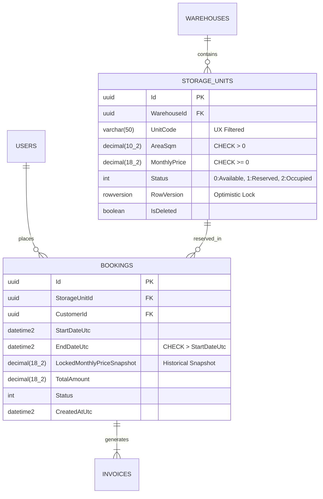

# Data Analysis & Database Architecture Skill

Use this skill whenever the user asks to analyze data, design a database schema, draw an ERD, normalize tables, optimize slow SQL queries/indexes, or generate SQL DDL / EF Core entity configurations.

---

## 1. Mandatory 6-Stage Data Analysis & DB Design Pipeline

Never create tables blindly without completing these 6 analytical stages:

### Stage 1: Entity Discovery & Table Classification
Extract all nouns, events, and states from the requirements or raw data and classify every table into one of 5 archetypes:
1. **`Core / Master Entities`:** Independent domain objects (`Users`, `Customers`, `Products`, `Warehouses`, `StorageUnits`).
2. **`Transactional Entities`:** Time-bound business actions (`Orders`, `Bookings`, `Contracts`, `Payments`, `Invoices`).
3. **`Junction / Associative Tables`:** Resolve `N:M` relationships (`OrderItems`, `UserRoles`, `BookingAddons`) — always promote to a first-class entity if it carries payload attributes (`Quantity`, `UnitPrice`, `AssignedAtUtc`).
4. **`Reference / Lookup Tables`:** Controlled vocabularies or hierarchical categories (`Categories`, `Permissions`, `Regions`).
5. **`Audit / Temporal / Outbox Tables`:** Immutable logs for traceability (`AuditLogs`, `InventoryTransactions`, `OutboxMessages`).

### Stage 2: Normalization (`3NF`/`BCNF`) + Strategic Snapshot Denormalization
1. **1NF:** Atomic columns only (never store comma-separated IDs like `"1,4,7"` in a `VARCHAR` column).
2. **2NF & 3NF:** Every non-key attribute must depend solely on the whole Primary Key. Extract repeated groups and transitive dependencies into separate tables.
3. **Strategic Historical Snapshots (Crucial Production Rule):**
   - Whenever a transactional table (`OrderItems`, `InvoiceLines`, `ContractTerms`) references mutable master data (`Product.Price`, `StorageUnit.MonthlyRate`, `Customer.Address`), **MUST store a snapshot column** (`UnitPriceSnapshot`, `TaxRateSnapshot`, `BillingAddressSnapshot`) on the transaction row so future master-data updates never corrupt historical financial records.

### Stage 3: Strict Data Type, Key & Constraint Governance
| Data Category | SQL Server (`T-SQL`) | PostgreSQL | Mandatory Rule |
| :--- | :--- | :--- | :--- |
| **Primary Key (`PK`)** | `UNIQUEIDENTIFIER` (UUIDv7) or `BIGINT IDENTITY(1,1)` | `UUID` (UUIDv7) or `BIGINT GENERATED ALWAYS AS IDENTITY` | Never use random UUIDv4 on clustered indexes without sequential ordering. |
| **Currency / Money / Area** | `DECIMAL(18, 2)` / `DECIMAL(19, 4)` | `NUMERIC(18, 2)` / `NUMERIC(19, 4)` | **STRICTLY FORBIDDEN** to use `FLOAT` or `REAL` for money, rates, or measurements. |
| **Strings (Bounded)** | `NVARCHAR(50..500)` / `VARCHAR(50)` | `VARCHAR(50..500)` | Always set explicit max lengths (`Email: 255`, `Phone: 20`, `Code: 50`). Avoid `MAX` unless storing rich text. |
| **Timestamps (UTC)** | `DATETIME2(3)` or `DATETIMEOFFSET` | `TIMESTAMPTZ` | Always store timestamps in **UTC** (`CreatedAtUtc`, `StartDateUtc`). |
| **Semi-Structured Metadata** | `NVARCHAR(MAX)` + `ISJSON` check | `JSONB` (with GIN index) | Use only for dynamic extensible attributes, never as a substitute for core relational columns. |
| **Concurrency Token** | `ROWVERSION` | `xmin` / `INT Version` | Mandatory on high-contention tables (`Inventory`, `Wallets`, `StorageUnits`, `Bookings`). |

### Stage 4: Soft-Delete & Filtered Unique Index Integrity
- Every core business table should include audit columns (`CreatedAtUtc`, `CreatedBy`, `UpdatedAtUtc`, `UpdatedBy`) and soft-delete columns (`IsDeleted`, `DeletedAtUtc`).
- **The Soft-Delete Unique Trap:** Never put a naive `UNIQUE(Email)` or `UNIQUE(Code)` constraint on a soft-deletable table (otherwise a deleted record blocks re-creating the same code/email). Always use a **Filtered / Partial Unique Index**:
  
```sql
  CREATE UNIQUE INDEX UX_Users_Email_Active ON Users(Email) WHERE IsDeleted = 0;
  
```

### Stage 5: High-Performance Indexing Strategy (The `ESR` Rule)
1. **Foreign Key Indexing:** Automatically create a non-clustered index on **every** Foreign Key column (`IX_<TableName>_<ForeignKeyColumn>`) to prevent full table scans during `JOIN` and `ON DELETE` checks.
2. **ESR Composite Index Rule (`Equality -> Sort -> Range`):**
   - Order columns in composite indexes strictly by:
     1. **E (Equality):** Exact match columns (`WHERE Status = 1 AND WarehouseId = @id`)
     2. **S (Sort):** `ORDER BY CreatedAtUtc DESC`
     3. **R (Range):** `AND Price BETWEEN 100 AND 500`
   - Use `INCLUDE (...)` for covering queries on heavy read endpoints.

### Stage 6: Referential Integrity (`ON DELETE` Behavior)
- **Never enable blanket `ON DELETE CASCADE`** on core financial or transactional hierarchies (`Users -> Orders`, `StorageUnits -> Bookings`). Use `ON DELETE RESTRICT` / `NO ACTION` so parent records with historical transactions cannot be accidentally wiped out.
- Use `ON DELETE CASCADE` only for tightly owned child value collections (`Order -> OrderStatusHistory` or `Post -> PostTags`).

---

## 2. Mandatory Deliverable Output Format

Whenever designing a database for the user, deliver these 4 synchronized artifacts:

### 1. Entity Dictionary & Relationship Summary Table
| Table Name | Category | Primary Key | Foreign Keys & Cardinality | Key Invariants / Check Constraints |
| :--- | :--- | :--- | :--- | :--- |
| `StorageUnits` | Master | `Id (UUID)` | `WarehouseId -> Warehouses.Id (N:1)` | `CHECK (AreaSqm > 0 AND BasePrice >= 0)` |
| `Bookings` | Transactional | `Id (UUID)` | `UnitId -> StorageUnits.Id (N:1)`, `CustomerId -> Users.Id (N:1)` | `CHECK (EndDateUtc > StartDateUtc)` |

### 2. Visual ERD (`Mermaid.js erDiagram`)


### 3. Production SQL DDL Script (With Check Constraints & ESR Indexes)
```sql
CREATE TABLE StorageUnits (
    Id UNIQUEIDENTIFIER NOT NULL CONSTRAINT PK_StorageUnits PRIMARY KEY DEFAULT NEWSEQUENTIALID(),
    WarehouseId UNIQUEIDENTIFIER NOT NULL,
    UnitCode VARCHAR(50) NOT NULL,
    AreaSqm DECIMAL(10, 2) NOT NULL,
    MonthlyPrice DECIMAL(18, 2) NOT NULL,
    Status INT NOT NULL CONSTRAINT DF_StorageUnits_Status DEFAULT (0),
    CreatedAtUtc DATETIME2(3) NOT NULL CONSTRAINT DF_StorageUnits_CreatedAt DEFAULT SYSUTCDATETIME(),
    UpdatedAtUtc DATETIME2(3) NULL,
    IsDeleted BIT NOT NULL CONSTRAINT DF_StorageUnits_IsDeleted DEFAULT (0),
    RowVersion ROWVERSION NOT NULL,

    CONSTRAINT FK_StorageUnits_Warehouses FOREIGN KEY (WarehouseId)
        REFERENCES Warehouses (Id) ON DELETE NO ACTION,
    CONSTRAINT CK_StorageUnits_PositiveMetrics CHECK (AreaSqm > 0 AND MonthlyPrice >= 0)
);

-- Filtered Unique Index supporting Soft Delete
CREATE UNIQUE NONCLUSTERED INDEX UX_StorageUnits_Warehouse_Code_Active
    ON StorageUnits (WarehouseId, UnitCode)
    WHERE IsDeleted = 0;

-- ESR Composite Index (Equality: WarehouseId, Status -> Sort: MonthlyPrice -> Include: AreaSqm)
CREATE NONCLUSTERED INDEX IX_StorageUnits_Search_ESR
    ON StorageUnits (WarehouseId, Status, MonthlyPrice ASC)
    INCLUDE (UnitCode, AreaSqm)
    WHERE IsDeleted = 0;
```

### 4. Clean Architecture EF Core `IEntityTypeConfiguration<T>`
```csharp
using Microsoft.EntityFrameworkCore;
using Microsoft.EntityFrameworkCore.Metadata.Builders;
using Project.Domain.Entities;

namespace Project.Infrastructure.Data.Configurations;

public sealed class StorageUnitConfiguration : IEntityTypeConfiguration<StorageUnit>
{
    public void Configure(EntityTypeBuilder<StorageUnit> builder)
    {
        builder.ToTable("StorageUnits", t =>
        {
            t.HasCheckConstraint("CK_StorageUnits_PositiveMetrics", "[AreaSqm] > 0 AND [MonthlyPrice] >= 0");
        });

        builder.HasKey(x => x.Id);

        builder.Property(x => x.UnitCode)
            .HasMaxLength(50)
            .IsUnicode(false)
            .IsRequired();

        builder.Property(x => x.AreaSqm)
            .HasPrecision(10, 2)
            .IsRequired();

        builder.Property(x => x.MonthlyPrice)
            .HasPrecision(18, 2)
            .IsRequired();

        builder.Property(x => x.RowVersion)
            .IsRowVersion();

        // Global Soft-Delete Query Filter
        builder.HasQueryFilter(x => !x.IsDeleted);

        // Filtered Unique Index
        builder.HasIndex(x => new { x.WarehouseId, x.UnitCode })
            .HasDatabaseName("UX_StorageUnits_Warehouse_Code_Active")
            .IsUnique()
            .HasFilter("[IsDeleted] = 0");

        // ESR Search Index
        builder.HasIndex(x => new { x.WarehouseId, x.Status, x.MonthlyPrice })
            .HasDatabaseName("IX_StorageUnits_Search_ESR")
            .IncludeProperties(x => new { x.UnitCode, x.AreaSqm })
            .HasFilter("[IsDeleted] = 0");

        builder.HasOne(x => x.Warehouse)
            .WithMany(w => w.StorageUnits)
            .HasForeignKey(x => x.WarehouseId)
            .OnDelete(DeleteBehavior.Restrict);
    }
}
```

---

## 3. Automated Raw Dataset Profiler (`CSV / JSON` $\rightarrow$ SQL Schema Generator)

When the user provides raw `.csv` or `.json` files and wants to analyze data distributions, detect anomalies/nulls, and auto-generate a normalized SQL schema, execute this Python profiling script:

```python
import csv
import re
import sys
from pathlib import Path


def infer_sql_column_type(values: list[str]) -> tuple[str, bool]:
    """Infers optimal SQL data type and nullability from sample column values."""
    non_empty = [v.strip() for v in values if v is not None and v.strip() != ""]
    is_nullable = len(non_empty) < len(values)

    if not non_empty:
        return "NVARCHAR(255)", True

    # Boolean check
    if all(v.lower() in {"true", "false", "0", "1", "yes", "no"} for v in non_empty):
        return "BIT", is_nullable

    # Integer check
    if all(re.fullmatch(r"-?\d+", v) for v in non_empty):
        max_val = max(abs(int(v)) for v in non_empty)
        return ("BIGINT" if max_val > 2_147_483_647 else "INT"), is_nullable

    # Decimal / Currency check
    if all(re.fullmatch(r"-?\d+(\.\d+)?", v) for v in non_empty):
        return "DECIMAL(18, 2)", is_nullable

    # ISO Date / Timestamp check
    if all(re.fullmatch(r"\d{4}-\d{2}-\d{2}([ T]\d{2}:\d{2}(:\d{2}(\.\d+)?)?.*)?", v) for v in non_empty):
        return "DATETIME2(3)", is_nullable

    # String length bucket sizing
    max_len = max(len(v) for v in non_empty)
    if max_len <= 50:
        bucket = 50
    elif max_len <= 100:
        bucket = 100
    elif max_len <= 255:
        bucket = 255
    elif max_len <= 500:
        bucket = 500
    else:
        return "NVARCHAR(MAX)", is_nullable

    return f"NVARCHAR({bucket})", is_nullable


def profile_csv_to_sql_ddl(csv_path: str, table_name: str = "ImportedEntity"):
    path = Path(csv_path)
    with path.open("r", encoding="utf-8-sig", newline="") as f:
        reader = csv.DictReader(f)
        rows = list(reader)
        headers = reader.fieldnames or []

    print(f"=== DATA PROFILE REPORT: {path.name} ({len(rows)} rows) ===")
    col_defs = [
        "    Id UNIQUEIDENTIFIER NOT NULL PRIMARY KEY DEFAULT NEWSEQUENTIALID()"
    ]

    for col in headers:
        col_vals = [r.get(col, "") for r in rows]
        sql_type, nullable = infer_sql_column_type(col_vals)
        distinct_count = len(set(v for v in col_vals if v))
        null_count = sum(1 for v in col_vals if not v or not v.strip())
        safe_col = re.sub(r"[^a-zA-Z0-9_]", "_", col.strip())

        print(f"- {safe_col:25} | Type: {sql_type:15} | Nulls: {null_count:4} | Distinct: {distinct_count:5}")
        null_sql = "NULL" if nullable else "NOT NULL"
        col_defs.append(f"    [{safe_col}] {sql_type} {null_sql}")

    col_defs.append("    CreatedAtUtc DATETIME2(3) NOT NULL DEFAULT SYSUTCDATETIME()")
    ddl = f"CREATE TABLE [{table_name}] (\n" + ",\n".join(col_defs) + "\n);"
    print("\n=== GENERATED SQL DDL ===\n" + ddl)


if __name__ == "__main__":
    if len(sys.argv) > 1:
        profile_csv_to_sql_ddl(sys.argv[1], sys.argv[2] if len(sys.argv) > 2 else "TargetTable")
```