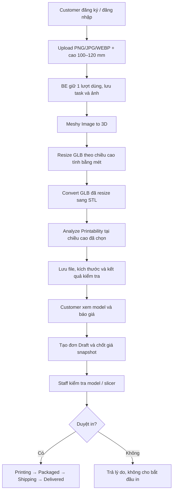

# Demo ảnh 2D → model 3D → báo giá → duyệt in

## Phạm vi và mức giá đã chốt

- Khách chọn chiều cao **100–120 mm (10–12 cm)** trước khi tạo model. API nhận số nguyên mm.
- Gói mặc định **390.000 VNĐ/mẫu**, số lượng 1–10. Giá 10 cm và 12 cm giống nhau.
- Tổng = giá gói × số lượng + phí giao hàng lấy từ cấu hình server. Demo mặc định giao hàng **0đ**, không phải báo giá vận chuyển thực tế.
- Chiều rộng và chiều sâu giữ nguyên tỷ lệ model; không suy ra kích thước vật thật từ ảnh.
- GLB được resize thật; STL được chuyển từ GLB đã resize, kiểm tra tỷ lệ và chuẩn hóa tọa độ sang mm.
- Thể tích mesh được hiển thị để tham khảo, **không dùng để tính giá gói** và không thay thế lượng nhựa/support/infill do slicer tính.
- Đây là BE. FE dùng các API bên dưới để hiển thị ảnh, tiến độ và viewer 3D. Staff tải STL sang slicer để kiểm tra hướng in/support và gửi tới máy in.
- Demo dùng thanh toán offline; không tự gọi cổng thanh toán, không tạo giao dịch hay đánh dấu đã trả tiền.

## Luồng sử dụng



Customer có thể tạo đơn Draft khi model hoàn tất và đang chờ Staff duyệt. Staff cũng có thể duyệt model trước khi khách đặt đơn. Chỉ model đã duyệt mới được chuyển đơn sang Printing.

Kết quả `healthy` không tự duyệt in. Staff phải duyệt riêng. Model không kín, kết quả `error` hoặc `unknown` không được duyệt qua API này. `warning` có thể được Staff duyệt sau khi kiểm tra, kèm ghi chú. Sửa mesh tự động chưa nằm trong demo.

Chiều cao đã chọn cố định cho mỗi task; đổi chiều cao hiện cần tạo task mới và tiêu tốn lượt/credit mới. Mục đích là giữ model, kích thước, kiểm tra độ dày và báo giá nhất quán.

## Role

| Role trong JWT/API | Quyền |
|---|---|
| `cus` | Tạo model; đọc và tải ảnh/model của mình; lấy báo giá; tạo/xem đơn của mình; hủy đơn Draft |
| `staff` | Các quyền cá nhân; xem task/đơn của tất cả khách; duyệt/từ chối in; cập nhật trạng thái đơn; đối soát task Meshy |
| `admin` | Quyền Staff; danh sách user; đổi role; cấp lượt tạo; đổi giá/kích hoạt gói in |

Đăng ký công khai chỉ tạo Customer. Request đăng ký có trường `role` bị từ chối. Role thực tế được đọc lại từ database trên mỗi request để token cũ mất quyền ngay khi bị hạ role. API không trả password hash hoặc API key.

Enum database giữ `Customer=0`, `Staff=2`, `Admin=3`. Migration đổi tài khoản PartnerLab cũ (`1`) sang Staff; Operator cũ (`2`) tương ứng Staff. Bảng PartnerLabs vẫn giữ để bảo toàn dữ liệu xưởng/đơn cũ.

## API cho FE

| Method / route | Input / kết quả |
|---|---|
| `POST /api/auth/register` | JSON `email`, `password` (10–128 ký tự), `fullName`; trả JWT |
| `POST /api/auth/login` | JSON `email`, `password`; trả JWT |
| `GET /api/auth/me` | User hiện tại, role và lượt còn lại |
| `GET /api/pricing-packages` | Các gói đang bán và giới hạn chiều cao |
| `POST /api/generations/image` | Multipart `image`, `heightMm`, `shouldTexture`, `modelName`; header `Idempotency-Key: <UUID>`; trả 202 |
| `GET /api/generations` | Phân trang 20 task; khách chỉ thấy của mình |
| `GET /api/generations/{id}` | Trạng thái, stage, progress, dimensions, printability, đường dẫn file |
| `GET /api/generations/{id}/files/{image\|glb\|stl}` | File có xác thực và kiểm tra sở hữu |
| `GET /api/generations/{id}/quote?packageId=...&quantity=2` | Giá tính tại server và kích thước mm |
| `POST /api/generations/{id}/review` | Staff/Admin: `{ "approved": true, "note": "Đã kiểm tra slicer..." }` |
| `POST /api/generations/{id}/recover` | Staff/Admin: task ID đúng bước đang lỗi, xem phần phục hồi |
| `POST /api/orders` | Model, gói, số lượng, `expectedTotalVnd`, địa chỉ; `Idempotency-Key` riêng |
| `GET /api/orders`, `GET /api/orders/{id}` | Đơn hàng theo quyền sở hữu/role |
| `POST /api/orders/{id}/cancel` | Hủy đơn Draft |
| `PATCH /api/orders/{id}/status` | Staff/Admin: `status`, `note`, tùy chọn `trackingNumber` |
| `GET /api/admin/users` | Admin: phân trang 50 user |
| `PATCH /api/admin/users/{id}/role` | Admin: `{ "role": "staff" }` |
| `POST /api/admin/users/{id}/credits` | Admin: `{ "amount": 2 }`, cấp thêm lượt nội bộ |
| `PATCH /api/admin/pricing-packages/{id}` | Admin: `{ "priceVnd": 390000, "isActive": true }` |

Các route bảo vệ yêu cầu `Authorization: Bearer <token>`. File cũng cần header này: FE fetch file thành Blob rồi đưa Blob URL vào viewer; không đưa JWT vào query string.

FE poll GET task khoảng 5 giây/lần. `progress` là tiến độ tổng hợp của 4 bước, không phải thời gian còn lại. `status=succeeded` mới có báo giá hoàn chỉnh và STL đã kiểm tra kích thước. GLB có thể xuất hiện sớm hơn để preview.

`dimensions` dùng `widthMm`, `depthMm`, `heightMm`. Map nội bộ X=rộng, Y=sâu, Z=cao; không dùng quy ước này để suy ra trục up của mọi định dạng 3D.

Mỗi thao tác tạo mới dùng UUID mới. Khi gửi lại cùng thao tác do lỗi mạng, dùng lại UUID cũ và cùng payload. Payload khác với cùng key trả 409. `expectedTotalVnd` chỉ để phát hiện giá thay đổi: server luôn tính lại và trả 409 kèm báo giá mới nếu không khớp. Giá đơn đã lưu không thay đổi khi Admin sửa giá gói.

## Cấu hình và chạy local

Cần .NET SDK 10 và SQL Server. Chạy từ thư mục repository. Dùng database mới để demo; không chạy lại DDL cũ cùng với migrations.

```powershell
dotnet tool restore
dotnet restore

$env:ConnectionStrings__DefaultConnection = 'Server=localhost;Database=TheBoysDemoDb;Trusted_Connection=True;TrustServerCertificate=True'
$jwtBytes = New-Object byte[] 48
$rng = [Security.Cryptography.RandomNumberGenerator]::Create()
$rng.GetBytes($jwtBytes)
$rng.Dispose()
$env:JwtSettings__Secret = [Convert]::ToBase64String($jwtBytes)
$env:BootstrapAdmin__Email = 'admin@demo.local'
$adminPassword = Read-Host 'Mat khau Admin (12-128 ky tu)' -AsSecureString
$env:BootstrapAdmin__Password = [System.Net.NetworkCredential]::new('', $adminPassword).Password

dotnet run --project src/TheBoys.WebApi -- --initialize-database
Remove-Item Env:BootstrapAdmin__Password

$meshyKey = Read-Host 'Meshy API key' -AsSecureString
$env:AiProviders__Meshy__ApiKey = [System.Net.NetworkCredential]::new('', $meshyKey).Password
dotnet run --project src/TheBoys.WebApi --launch-profile http
```

Không gửi key qua chat hoặc commit vào Git. Environment trên chỉ sống trong PowerShell đang chạy. Có thể lưu cấu hình máy dev bằng .NET User Secrets; ID đã được khai báo trong WebApi. Khi chạy Production bắt buộc cung cấp JWT secret dài ít nhất 32 bytes. Development không có secret sẽ tạo key ngẫu nhiên mỗi lần chạy, nên token cũ hết hiệu lực sau restart.

API local: `http://localhost:5133`; OpenAPI JSON: `/openapi/v1.json`. File `TheBoys.WebApi.http` có mẫu request. Không có Swagger UI mặc định.

Lệnh initialize áp dụng migrations, seed gói 390k nếu chưa có, tạo Admin đầu tiên từ cấu hình. Nó không reset mật khẩu, không nâng role tài khoản đã có, không ghi đè bảng giá đã sửa. Sau đó đăng ký một tài khoản Staff như khách thường và dùng Admin đổi role sang `staff`.

Nếu database đã được tạo từ `database/TheBoys_Schema_DDL.sql`, không tự chèn migration history rồi chạy tiếp khi chưa đối chiếu schema. Dùng database demo mới là đường nhanh và an toàn; migration baseline cho DB cũ cần xác minh schema riêng. `Database:InitializeOnStartup` mặc định false để không tự sửa DB mỗi lần chạy app.

## Lượt dùng và credit Meshy

- Mỗi khách mới có 2 lượt tạo của ứng dụng. Đó là quota nội bộ; chi phí Meshy vẫn trừ ở tài khoản chủ API.
- Mặc định `meshy-6-lite`, tắt texture. Luồng gọi Image to 3D, Resize, Convert, Analyze: theo bảng giá kiểm tra 19/10/2026 là khoảng **7 credits/mẫu** khi tắt texture và **17 credits/mẫu** khi bật texture 2K. Giá provider có thể thay đổi.
- Chỉ hoàn quota ứng dụng một lần khi bước tạo model thất bại rõ ràng. Lỗi resize/convert/analyze không hoàn lượt vì model đã được tạo.
- Không có API key: POST tạo mẫu trả 503 và không trừ lượt.
- GET lỗi mạng/429/5xx tiếp tục kiểm tra task cũ. Không coi quá 180 giây là thất bại.
- POST timeout/5xx hoặc restart giữa lúc gửi và lưu ID chuyển `needsAttention`; không tự POST lại.
- Staff kiểm tra Developer Platform, tìm task thuộc đúng bước (`generate`, `resize`, `convert`, `analyze`) rồi gọi `/recover` với `providerTaskId`. Nếu ID đã lưu, có thể gửi `{}` để tiếp tục GET/tải file. Nếu không xác định được task ID, cần đối soát thủ công; không tự hoàn quota hoặc tự tạo lại.
- Worker lưu checkpoint trong SQL và dùng `sp_getapplock` để tránh hai worker gửi cùng bước. Khi triển khai nhiều instance, storage phải được chia sẻ; mặc định local `App_Data/models` phù hợp demo một máy.
- File được tải về storage riêng, không nằm trong `wwwroot`. URL Meshy có hạn sử dụng; nếu URL đã hết hạn và file chưa được lưu thì cần xử lý thủ công, GET task không gia hạn URL.

## Kiểm thử

Sau khi đồng bộ `main`, mở `TheBoys.sln` (WebApi là project đầu tiên) hoặc `TheBoys.slnx`; cả hai đều có project test.

Lịch sử EF giữ cả `InitialCreate` từ `main` và `InitialSchema` từ `2DTo3D`. Hai baseline kiểm tra lịch sử của nhau để chỉ tạo bảng một lần. Migration `MergeMainSchemaAlignment` đồng bộ độ chính xác thời gian, giới hạn độ dài và giá trị mặc định từ `main`. Database đã chạy một trong hai nhánh có thể chạy migration tiếp; tests kiểm tra cả database mới và nâng cấp từ từng nhánh. Nếu dữ liệu cũ vượt giới hạn mới (ví dụ ghi chú đơn hàng trên 500 ký tự), cần xử lý dữ liệu đó trước khi nâng cấp; migration không tự cắt nội dung.

```powershell
dotnet test TheBoys.slnx
```

Integration tests cần SQL Server local và quyền tạo/xóa **database test riêng** tên `TheBoys_Test_<UUID>`. Có thể đặt `THEBOYS_TEST_SQL` để đổi server/auth; test luôn thay database trong connection string bằng tên test mới. Tests không đọc/ghi database cấu hình cho ứng dụng.

Tests dùng Meshy giả lập và dữ liệu hình học nhỏ để kiểm tra luồng API, phân quyền, quota, chống trùng, giá snapshot, đổi đơn vị và phục hồi lỗi. Chúng không gọi API có tính phí và không xác nhận chất lượng model AI thật. Cần chạy thêm một ảnh thật sau khi cấu hình key để xác nhận tài khoản, credit và chất lượng bản in.

Các secret từng nằm trong appsettings đã được bỏ khỏi bản hiện tại; bản cũ còn có thể nằm trong lịch sử Git. Thu hồi/thay các credential cũ còn hiệu lực tại nhà cung cấp.

## Tài liệu provider đã đối chiếu

- [Image to 3D](https://docs.meshy.ai/en/api/image-to-3d)
- [Resize: chiều cao tính bằng mét](https://docs.meshy.ai/en/api/resize)
- [Convert](https://docs.meshy.ai/en/api/convert)
- [Analyze Printability: kích thước mm, thể tích m³](https://docs.meshy.ai/en/api/analyze-printability)
- [Task lifecycle và xử lý timeout](https://docs.meshy.ai/en/api/task-lifecycle)
- [API pricing](https://docs.meshy.ai/en/api/pricing)
