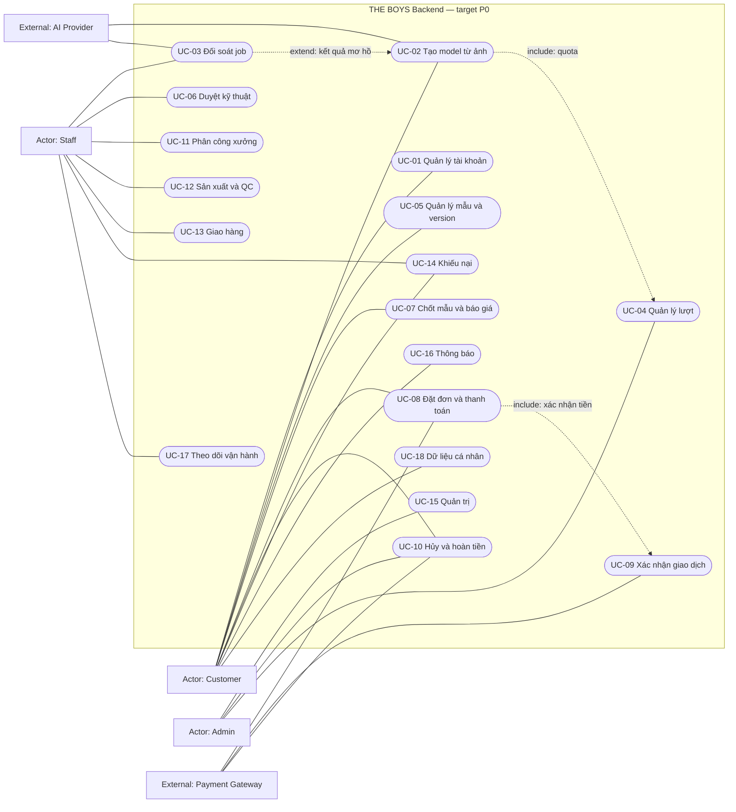
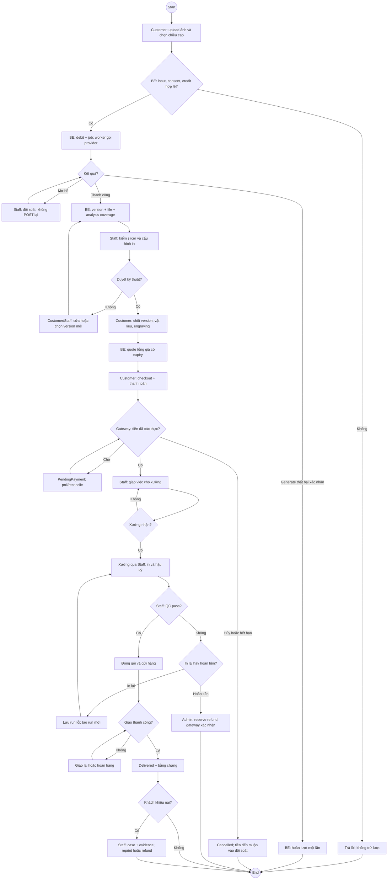
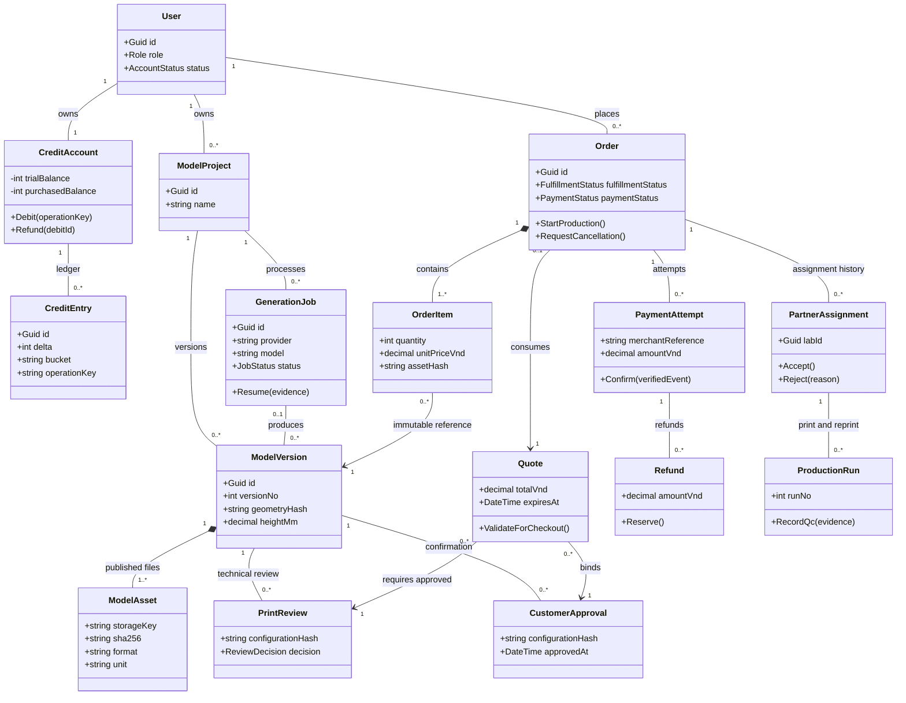
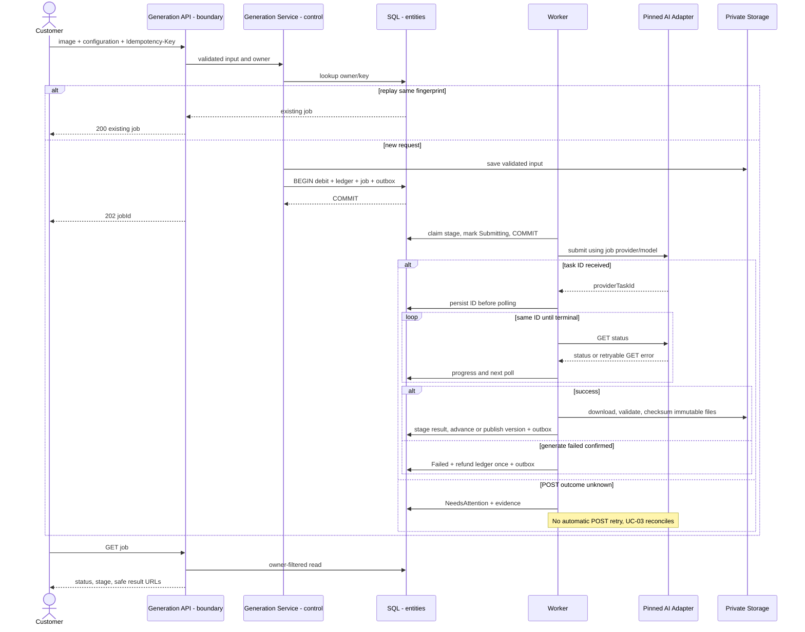
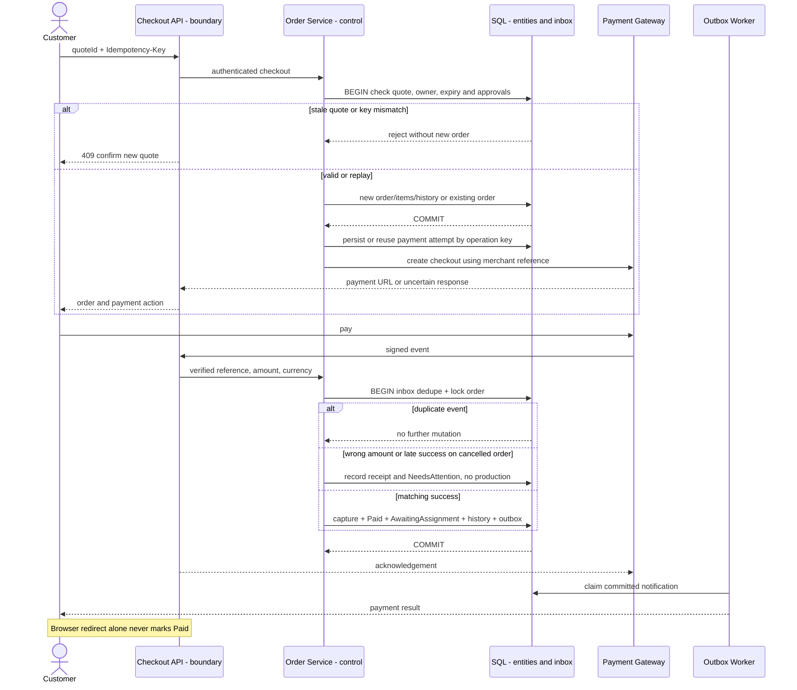
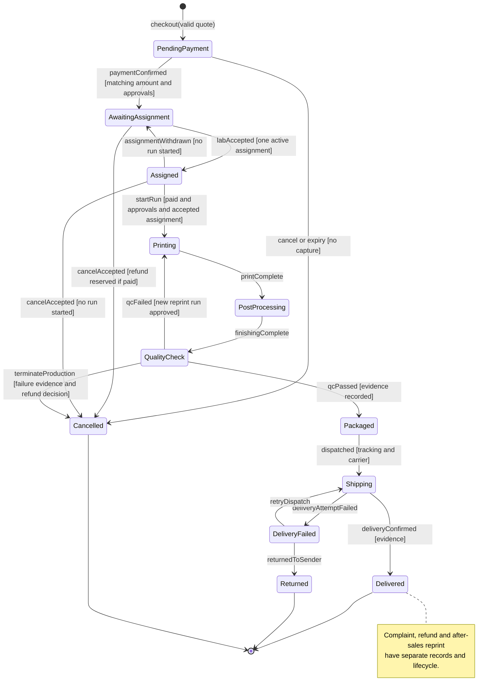
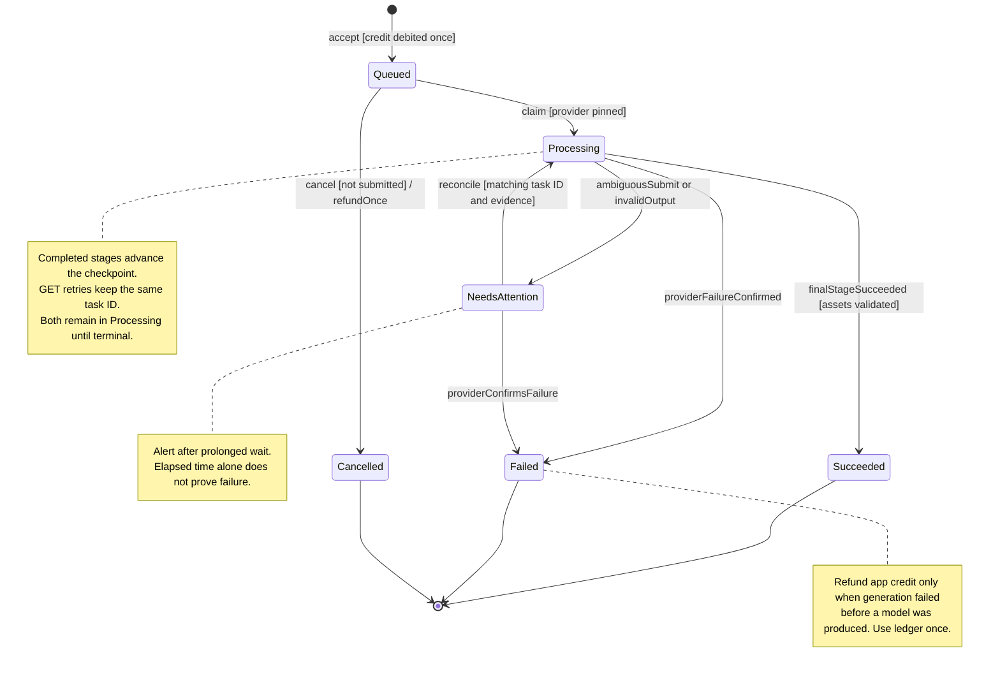
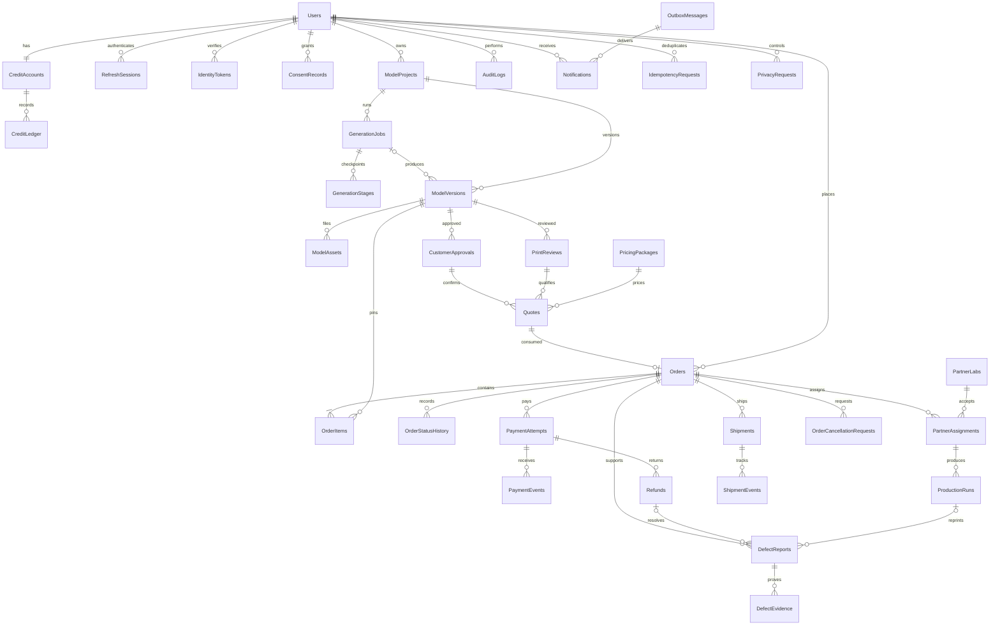
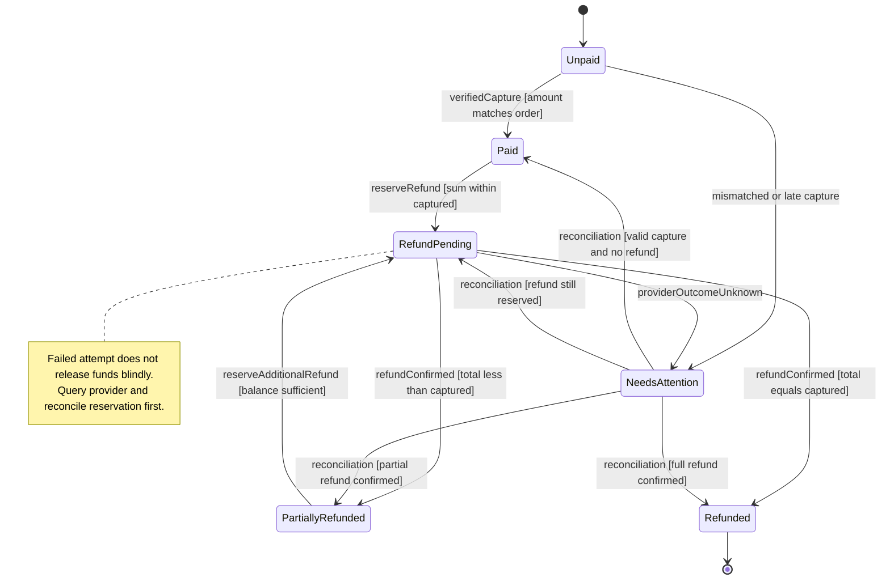
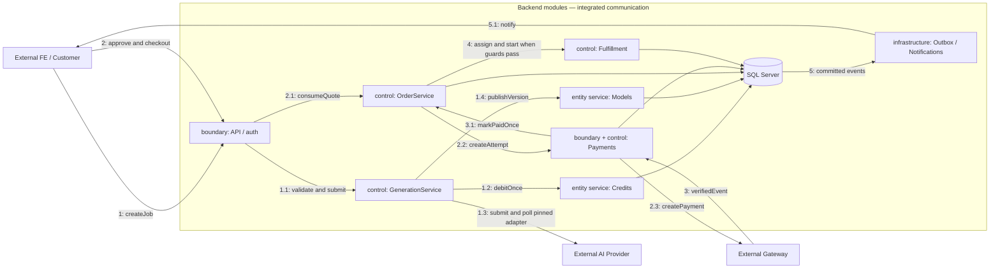

# Mermaid gallery — thiết kế mục tiêu

Nguồn chính là các file `.mmd`. File này được sinh bằng `node tools/diagrams/render.mjs`. Xem [giải thích và nguồn slide](../README.md).

## D01-use-cases

[Source](D01-use-cases.mmd)

## D02-order-activity

[Source](D02-order-activity.mmd)

## D03-domain-class

[Source](D03-domain-class.mmd)

## D04-generation-sequence

[Source](D04-generation-sequence.mmd)

## D05-payment-sequence

[Source](D05-payment-sequence.mmd)

## D06-order-state

[Source](D06-order-state.mmd)

## D07-generation-state

[Source](D07-generation-state.mmd)

## D08-core-erd

[Source](D08-core-erd.mmd)

## D09-payment-state

[Source](D09-payment-state.mmd)

## D10-communication

[Source](D10-communication.mmd)

