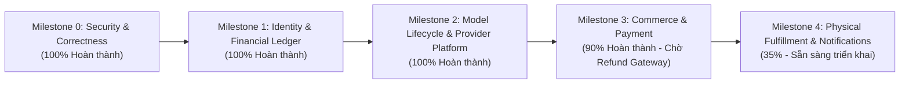

# BÁO CÁO TIẾN ĐỘ VÀ RÀ SOÁT HỆ THỐNG THEO BMAD RETROSPECTIVE
## Dự án: THE BOYS / PRINT3D — Backend .NET Core & Distributed Workflows
**Mốc đánh giá:** Ngày 23/10/2026 (Giờ Việt Nam)  
**Tài liệu mốc yêu cầu:** [`EXE101_Deep_Research_Bao_cao_Tieng_Viet.md`](../../docs/planning/EXE101_Deep_Research_Bao_cao_Tieng_Viet.md) (Đối chiếu commit baseline `c458097` ngày 20/10/2026)
**Phạm vi khảo sát bằng chứng (Evidence):** Toàn bộ mã nguồn thực tế tại `src/TheBoys.Domain/`, `src/TheBoys.Application/`, `src/TheBoys.Infrastructure/`, `src/TheBoys.WebApi/`, `database/`, và `tests/`.

---

## 1. TÓM TẮT TỔNG QUAN TIẾN ĐỘ

### 1.1. So sánh tổng quát với mốc nghiên cứu ban đầu (20/10/2026)
Tại thời điểm mốc Deep Research (20/10/2026), backend chủ yếu là **luồng demo tĩnh**:
> `Upload ảnh → AI generate (1 provider toàn cục) → Phân tích STL (lệch trục Z) → Duyệt ghi đè trên task → Tạo đơn demo offline (paymentMode = "demo_offline_no_online_charge")`
> *Kết quả kiểm thử baseline:* 20 tests pass. Database runtime chỉ có 6 bảng đơn giản.

Trải qua các đợt hoàn thiện liên tiếp các ticket P0 kỹ thuật (`SEC-A01`, `COR-A02`, `CI-B01`, `ID-A03`, `DATA-A04`, `AI-A06`, `MODEL-A05`, `AI-A07`, `ORDER-B02`, `ORDER-B03`, `PAY-B04`, `PAY-B05`), hệ thống hiện tại đã sở hữu:
- **78/78 tests PASS (100%)**, chạy trên SQL Server LocalDB thật kết hợp adapter sandbox/mock.
- **11 bảng thực thể mới được thêm qua EF Core Migrations tiến (Forward-only)**, nâng tổng số thực thể quản lý trong `IApplicationDbContext` lên **17 thực thể**.
- Toàn bộ trục nghiệp vụ cốt lõi: **Xác thực phiên (Identity) → Sổ cái credit (Ledger) → Vòng đời model (ModelVersion/Asset) → Ghim AI Provider (Pinning) → Kỹ thuật duyệt (PrintReview) → Khách hàng chốt mẫu (CustomerApproval) → Báo giá đóng băng (Persisted Quote) → Tạo đơn nguyên tử (Atomic Checkout v2) → Khởi tạo thanh toán 2 bước (PaymentAttempt) → Webhook xác thực chữ ký (PaymentEvent Inbox)** đã được hiện thực hóa bằng mã nguồn chạy thực tế và có test bảo vệ bất biến.

### 1.2. Thống kê theo 32 luồng nghiệp vụ (Business Flows F01 → F32)

| Trạng thái | Mốc Deep Research (20/10/2026) | Thực tế Codebase Hiện tại (23/10/2026) | Thay đổi thực chất |
|---|:---:|:---:|---|
| **Đã hoàn thành (Có code & test đầy đủ)** | 13 (40,6%) | **16 (50,0%)** | +3 luồng nghiệp vụ P0 hoàn chỉnh |
| **Một phần (Entity / Schema / Khung xử lý)** | 9 (28,1%) | **12 (37,5%)** | Nâng cấp toàn diện Data Model và logic cốt lõi |
| **Chưa triển khai (P1 / P2 / Backlog tiếp theo)** | 10 (31,3%) | **4 (12,5%)** | Giảm thiểu 6 luồng chưa làm nhờ hoàn thành P0 |
| **Tổng cộng** | **32 (100%)** | **32 (100%)** | |

> [!NOTE]
> 16 luồng hoàn thành hiện tại đã bao phủ toàn bộ các luồng nhạy cảm nhất về **Tiền (Credits/VND)** và **Tính đúng đắn hình học (Geometry/Version)**, thay vì chỉ là các luồng demo như trước.

### 1.3. Tiến độ theo Roadmap Milestones



1. **Milestone 0 — Bảo mật & Sửa lỗi hình học (SEC-A01, COR-A02, CI-B01):** **100% ĐẠT**
   - Loại bỏ credential khỏi code theo dõi, cấu hình secret bên ngoài.
   - Sửa thuật toán scale STL theo up-axis chuẩn hóa (`ModelUpAxis.Z/Y/X`).
   - Reverse proxy header allowlist, ngăn chặn giả mạo IP nguồn.
2. **Milestone 1 — Định danh & Nền tảng sổ cái tài chính (ID-A03, DATA-A04):** **100% ĐẠT**
   - Vòng đời định danh: Verify email (OTP hash), Password reset (Single-use token), Refresh session family (Phát hiện reuse token), Logout/Revocation, Account lockout sau 5 lần sai.
   - Sổ cái credit append-only: `CreditAccounts` + `CreditLedger` (Trial grant, Generation debit, Generation refund đảo ngược có đối soát `ReversesEntryId`, Admin grant có lý do/actor/key).
   - Hạ tầng bất biến: `AuditLogs`, `OutboxMessages`, `IdempotencyRequests`.
3. **Milestone 2 — Vòng đời Model & Nền tảng Provider (MODEL-A05, AI-A06, AI-A07):** **100% ĐẠT**
   - Phân rã `GenerationTask` sang `ModelProject → GenerationJob → GenerationStage → ModelVersion → ModelAsset`.
   - Bất biến SHA-256 geometry hash và asset hash.
   - `IModelProviderRegistry`: Đăng ký song song Meshy và Tripo; ghim provider/model/version theo từng job; đổi mặc định không làm sai lệch job đang chạy.
   - Thu thập chi phí AI thực tế (`ProviderCredits`, `ActualCostVnd`).
4. **Milestone 3 — Báo giá, Checkout & Thanh toán (ORDER-B02, ORDER-B03, PAY-B04, PAY-B05):** **90% ĐẠT**
   - `PrintReview` append-only cho Staff quản trị, checklist slicer vật lý.
   - `CustomerApproval` append-only cho chủ sở hữu model, chuẩn hóa `ConfigurationHash` SHA-256.
   - `Quote` lưu DB bất biến, TTL 30 phút, đóng băng snapshot tài chính.
   - Checkout atomic v2: `POST /api/v2/orders` tạo đồng thời `Order` + `OrderItem` + `OrderStatusHistory` (Fulfillment: `PendingPayment`, Payment: `Unpaid`), lọc trùng bằng index `UX_Orders_QuoteId`.
   - `PaymentAttempt` 2 bước: Persist DB trước khi gọi HTTP ra ngoài.
   - `PaymentEvents` Inbox: Xác thực HMAC-SHA256, replay window 5 phút, idempotent ACK cho duplicate event, cập nhật atomic sang `Paid` + `AwaitingAssignment`.
   - *Phần còn lại:* Cổng gọi hoàn tiền (`Refunds` table và gateway refund call) được chuyển giao sang ticket `REFUND-B06`.
5. **Milestone 4 — Sản xuất, Đối tác, Vận chuyển & Thông báo (OPS-B06, OPS-B07, EVT-B08):** **35% ĐẠT**
   - Đã có nền tảng cấu trúc dữ liệu (`PartnerLabs`, `OrderStatus`, trường snapshot chi phí).
   - Chưa triển khai luồng giao việc (`PartnerAssignments`), chạy máy in (`ProductionRuns`), vận chuyển (`Shipments`) và worker phát thông báo từ Outbox.

---

## 2. BẢNG ĐỐI CHIẾU CHI TIẾT SPEC (DEEP RESEARCH) VS. BUILT (THỰC TẾ)

| Mã | Luồng Nghiệp Vụ / Hạng Mục | Yêu Cầu Trong Báo Cáo Deep Research | Tình Trạng | Bằng Chứng Mã Nguồn & Kiểm Thử Cụ Thể |
|---|---|---|:---:|---|
| **F01** | Vòng đời tài khoản (Đăng ký, Đăng nhập) | Đăng ký tài khoản Customer, chuẩn hóa email, hash mật khẩu BCrypt/Identity, xác thực email qua OTP, khóa tài khoản nếu nhập sai. | **Hoàn thành** | - [`AuthController.cs`](../../src/TheBoys.WebApi/Controllers/AuthController.cs): `Register`, `Login`, `VerifyEmail`, `ResendVerification`<br>- [`User.cs`](../../src/TheBoys.Domain/Entities/User.cs): Phương thức `RecordFailedLogin`, `ResetFailedLogins`, `VerifyEmail`<br>- [`IdentityToken.cs`](../../src/TheBoys.Domain/Entities/IdentityToken.cs): Token OTP hash 6 ký tự |
| **F02** | Quản lý phiên, Reset mật khẩu & Thu hồi | Refresh token rotation theo Family ID; phát hiện tái sử dụng token (reuse detection); Reset mật khẩu qua single-use token; Logout thu hồi toàn bộ session. | **Hoàn thành** | - [`AuthController.cs`](../../src/TheBoys.WebApi/Controllers/AuthController.cs): `RefreshToken`, `Logout`, `ForgotPassword`, `ResetPassword`<br>- [`RefreshSession.cs`](../../src/TheBoys.Domain/Entities/RefreshSession.cs): `FamilyId`, `TokenHash`, `Revoke`, `ReplaceWith`<br>- Test: `AuthTests.cs` |
| **F03** | Tải ảnh và tạo tác vụ 3D | Kiểm tra Idempotency UUID; giới hạn dung lượng ≤ 15 MiB; giải mã ảnh thực tế (decode Skia); ràng buộc pixel; trừ 1 credit atomical; ghi nhận consent. | **Hoàn thành** | - [`GenerationsController.cs`](../../src/TheBoys.WebApi/Controllers/GenerationsController.cs): `Create`<br>- [`SkiaImageValidationService.cs`](../../src/TheBoys.Infrastructure/Services/SkiaImageValidationService.cs): Decode byte ảnh thật, chặn payload giả mạo<br>- [`ConsentRecord.cs`](../../src/TheBoys.Domain/Entities/ConsentRecord.cs) |
| **F04** | Text-to-3D | Hỗ trợ prompt văn bản, trừ credit tương tự Image-to-3D, kiểm tra capability adapter. | **Một phần** | - [`DomainEnums.cs`](../../src/TheBoys.Domain/Enums/DomainEnums.cs): `TaskType.TextTo3D`<br>- [`GenerationJob.cs`](../../src/TheBoys.Domain/Entities/GenerationJob.cs): `Operation = 'TextTo3D'`, cột `Prompt`<br>- *Chưa có public API controller riêng cho khách hàng* |
| **F05** | Multi-view (Nhiều góc ảnh) | Tiếp nhận nhiều ảnh, tổng hợp không gian 3D. | **Chưa làm** | - Thuộc phạm vi P2 trong SRS; chưa có API tiếp nhận danh sách ảnh. |
| **F06** | Quy trình sinh model (Worker & Pipeline) | Pipeline bất đồng bộ: Generate → Resize → Convert → Analyze; checkpoint trạng thái trước side-effect; chuẩn hóa STL. | **Hoàn thành** | - [`GenerationWorker.cs`](../../src/TheBoys.Infrastructure/Printing/GenerationWorker.cs)<br>- [`GenerationProcessor.cs`](../../src/TheBoys.Infrastructure/Printing/GenerationProcessor.cs)<br>- [`StlGeometry.cs`](../../src/TheBoys.Infrastructure/Printing/StlGeometry.cs): Phân tích mesh watertight, scale theo up-axis |
| **F07** | Xử lý timeout và Recover tác vụ | Không gửi retry POST mù khi timeout; chuyển `NeedsAttention`; lệnh recover kiểm tra task ID có thuộc job gốc. | **Hoàn thành** | - [`RecoverGenerationTaskCommand.cs`](../../src/TheBoys.Application/Generations/Commands/RecoverGenerationTask/RecoverGenerationTaskCommand.cs)<br>- [`GenerationProcessor.cs`](../../src/TheBoys.Infrastructure/Printing/GenerationProcessor.cs): Đánh dấu `NeedsAttention` khi submit timeout |
| **F08** | Hoàn trả credit khi tác vụ lỗi | Hoàn credit tự động đúng 1 lần khi thất bại xác định; ghi sổ cái reversal; chống hoàn trùng. | **Hoàn thành** | - [`CreditService.cs`](../../src/TheBoys.Infrastructure/Services/CreditService.cs): `RefundForGenerationAsync`<br>- [`CreditLedgerEntry.cs`](../../src/TheBoys.Domain/Entities/CreditLedgerEntry.cs): `CreateGenerationRefund` với `ReversesEntryId`<br>- Ràng buộc Unique Index: `UX_Ledger_RefundOnce` |
| **F09** | Danh sách, xem và tải Model Asset | Kiểm tra quyền sở hữu; không dùng URL tạm của AI provider; stream file từ storage riêng tư; header `private, no-store`. | **Hoàn thành** | - [`GenerationsController.cs`](../../src/TheBoys.WebApi/Controllers/GenerationsController.cs): `DownloadFile`, `GetById`<br>- [`LocalModelStorage.cs`](../../src/TheBoys.Infrastructure/Printing/LocalModelStorage.cs): Lưu trữ file cô lập với SHA-256 |
| **F10** | Quản lý phiên bản Model (ModelVersion) | Phân tách Project/Job/Version/Asset; ModelVersion bất biến sau khi xuất xưởng; lưu GeometryHash. | **Hoàn thành** | - [`ModelProject.cs`](../../src/TheBoys.Domain/Entities/ModelProject.cs)<br>- [`ModelVersion.cs`](../../src/TheBoys.Domain/Entities/ModelVersion.cs): `GeometryHash`, kích thước vật lý, `AnalysisJson`<br>- [`ModelAsset.cs`](../../src/TheBoys.Domain/Entities/ModelAsset.cs): GLB, STL, Purpose |
| **F11** | Staff thẩm định kỹ thuật in (PrintReview) | Lịch sử duyệt append-only gắn với `ModelVersion`; checklist slicer vật lý; không cho ghi đè; chỉ role Management duyệt. | **Hoàn thành** | - [`PrintReview.cs`](../../src/TheBoys.Domain/Entities/PrintReview.cs): Aggregate append-only<br>- [`CreatePrintReviewCommandHandler.cs`](../../src/TheBoys.Application/Reviews/Commands/CreatePrintReview/CreatePrintReviewCommandHandler.cs)<br>- [`PrintReviewsController.cs`](../../src/TheBoys.WebApi/Controllers/v2/PrintReviewsController.cs): `POST /api/v2/reviews` |
| **F12** | Khách hàng phê duyệt mẫu (CustomerApproval) | Chỉ chủ sở hữu model được duyệt; khóa cấu hình in bằng `ConfigurationHash` SHA-256 bất biến; lưu policy version. | **Hoàn thành** | - [`CustomerApproval.cs`](../../src/TheBoys.Domain/Entities/CustomerApproval.cs): Aggregate append-only<br>- [`DeterministicConfigurationHasher.cs`](../../src/TheBoys.Infrastructure/Services/DeterministicConfigurationHasher.cs)<br>- [`CustomerApprovalsController.cs`](../../src/TheBoys.WebApi/Controllers/v2/CustomerApprovalsController.cs): `POST /api/v2/approvals` |
| **F13** | Gói giá và Báo giá đóng băng (Quote) | Báo giá lưu DB có version/expiry (TTL 30 phút); kiểm tra khớp ModelVersion + ConfigHash giữa Review và Approval; snapshot giá/SLA. | **Hoàn thành** | - [`Quote.cs`](../../src/TheBoys.Domain/Entities/Quote.cs): Check constraint `CK_Quotes_Financials`, `CK_Quotes_Expiry`<br>- [`CreateQuoteCommandHandler.cs`](../../src/TheBoys.Application/Quotes/Commands/CreateQuote/CreateQuoteCommandHandler.cs)<br>- [`QuotesController.cs`](../../src/TheBoys.WebApi/Controllers/v2/QuotesController.cs): `POST /api/v2/quotes` |
| **F14** | Tạo đơn hàng (Checkout v2) | Checkout nguyên tử từ Quote hợp lệ; sinh `Order` + `OrderItem` + `OrderStatusHistory`; khóa race-condition bằng index duy nhất `QuoteId`. | **Hoàn thành** | - [`CheckoutQuoteCommandHandler.cs`](../../src/TheBoys.Application/Orders/Commands/CheckoutQuote/CheckoutQuoteCommandHandler.cs)<br>- [`OrderItem.cs`](../../src/TheBoys.Domain/Entities/OrderItem.cs)<br>- [`OrdersV2Controller.cs`](../../src/TheBoys.WebApi/Controllers/v2/OrdersV2Controller.cs): `POST /api/v2/orders` |
| **F15** | Tra cứu danh sách & Chi tiết đơn hàng | Trả về thông tin đơn hàng v2 kèm các dòng sản phẩm, snapshot địa chỉ và timeline lịch sử trạng thái 2 trục (Fulfillment/Payment). | **Hoàn thành** | - [`OrdersV2Controller.cs`](../../src/TheBoys.WebApi/Controllers/v2/OrdersV2Controller.cs): `GET /api/v2/orders/{id}`<br>- [`OrderV2Dto.cs`](../../src/TheBoys.Application/Orders/OrderV2Dto.cs) |
| **F16** | Hủy đơn hàng | Khách hủy đơn PendingPayment; đơn đã Paid phải qua xét duyệt; late success sau hủy chuyển trạng thái đối soát. | **Một phần** | - [`CancelOrderCommand.cs`](../../src/TheBoys.Application/Orders/Commands/CancelOrder/CancelOrderCommand.cs)<br>- Xử lý late webhook trên đơn Cancelled trong [`ProcessPaymentWebhookCommandHandler.cs`](../../src/TheBoys.Application/Payments/Commands/ProcessPaymentWebhook/ProcessPaymentWebhookCommandHandler.cs)<br>- *Chưa có quy trình hủy có hoàn tiền tự động* |
| **F17** | Thanh toán và Đối soát (Payment) | PaymentAttempt gắn Order; Webhook Inbox `PaymentEvents` có chữ ký HMAC-SHA256; Replay window 5 phút; cập nhật atomic sang Paid; đối soát bằng mã tham chiếu. | **Hoàn thành** | - [`PaymentAttempt.cs`](../../src/TheBoys.Domain/Entities/PaymentAttempt.cs)<br>- [`PaymentEvent.cs`](../../src/TheBoys.Domain/Entities/PaymentEvent.cs)<br>- [`SandboxPaymentGateway.cs`](../../src/TheBoys.Infrastructure/Payments/SandboxPaymentGateway.cs)<br>- [`SePayPaymentGateway.cs`](../../src/TheBoys.Infrastructure/Payments/SePayPaymentGateway.cs)<br>- [`PaymentWebhookController.cs`](../../src/TheBoys.WebApi/Controllers/v2/PaymentWebhookController.cs)<br>- [`PaymentReconciliationController.cs`](../../src/TheBoys.WebApi/Controllers/v2/PaymentReconciliationController.cs) |
| **F18** | Hoàn tiền (Refund) | Quy trình reserve/submit/reconcile; kiểm tra tổng hoàn ≤ tiền đã thu; chống hoàn trùng. | **Một phần** | - Đã có trạng thái `RefundPending` và ghi nhận Outbox cảnh báo staff trong [`ProcessPaymentWebhookCommandHandler.cs`](../../src/TheBoys.Application/Payments/Commands/ProcessPaymentWebhook/ProcessPaymentWebhookCommandHandler.cs)<br>- *Chưa có bảng `Refunds` và API gọi gateway refund* |
| **F19** | Nhà in & Phân công xưởng in | Quản lý danh bạ xưởng; giao việc có thời hạn; nhà in chấp nhận/từ chối; lưu lịch sử phân công. | **Một phần** | - [`PartnerLab.cs`](../../src/TheBoys.Domain/Entities/PricingPackage.cs): Bảng danh bạ xưởng<br>- [`Order.cs`](../../src/TheBoys.Domain/Entities/Order.cs): Cột `PartnerLabId`, `FulfillmentStatus = 'AwaitingAssignment'`<br>- *Chưa tạo bảng `PartnerAssignments`* |
| **F20** | Quản lý sản xuất & Kiểm định QC | Vòng đời in: Printing → PostProcessing → QualityCheck → Packaged; yêu cầu bằng chứng ảnh QC trước khi pass; in lại tạo run mới. | **Một phần** | - [`Order.cs`](../../src/TheBoys.Domain/Entities/Order.cs): Các mốc thời gian sản xuất và cờ `ReprintApproved`<br>- *Chưa tạo bảng `ProductionRuns` độc lập và endpoint upload bằng chứng QC* |
| **F21** | Giao hàng và Vận chuyển | Gán mã vận đơn; lưu bằng chứng giao hàng thành công/thất bại; cập nhật timeline `Shipping` / `Delivered`. | **Một phần** | - [`Order.cs`](../../src/TheBoys.Domain/Entities/Order.cs): `TrackingNumber`, trạng thái `Shipped`, `Delivered`<br>- *Chưa có bảng `Shipments` và `ShipmentEvents` riêng biệt* |
| **F22** | Tiếp nhận khiếu nại & Xử lý lỗi | Khách gửi report lỗi kèm ảnh bằng chứng; Staff/Admin đánh giá; duyệt in lại hoặc hoàn tiền. | **Một phần** | - [`Order.cs`](../../src/TheBoys.Domain/Entities/Order.cs): Cột `DefectReason`, `EvidencePhotoUrl`, `EstimatedDefectCostVnd`<br>- *Chưa có aggregate `DefectReports` riêng* |
| **F23** | Quản trị phân quyền tài khoản | Admin đổi role người dùng; khóa tài khoản; kiểm soát quyền Staff/Admin; ghi log audit. | **Hoàn thành** | - [`AdminController.cs`](../../src/TheBoys.WebApi/Controllers/AdminController.cs): `ChangeRole`, `LockAccount`<br>- [`AuditService.cs`](../../src/TheBoys.Infrastructure/Services/AuditService.cs) |
| **F24** | Quản trị cấp phát Credit | Admin cấp credit thủ công; bắt buộc lý do, người thao tác và idempotency key; ghi nhận vào sổ cái `CreditLedger`. | **Hoàn thành** | - [`AdminController.cs`](../../src/TheBoys.WebApi/Controllers/AdminController.cs): `GrantCredits`<br>- [`CreditService.cs`](../../src/TheBoys.Infrastructure/Services/CreditService.cs): `AdminGrantAsync`<br>- Test: `CreditServiceTests.cs` |
| **F25** | Quản lý gói giá dịch vụ | Gói giá có `VersionNo`, trạng thái `IsActive`, chiều cao tối thiểu/tối đa; đóng băng giá trên Quote/Order. | **Hoàn thành** | - [`PricingPackage.cs`](../../src/TheBoys.Domain/Entities/PricingPackage.cs)<br>- [`AdminController.cs`](../../src/TheBoys.WebApi/Controllers/AdminController.cs): `CreatePricingPackage`, `UpdatePricingPackage`<br>- Snapshot cố định trên Quote/Order |
| **F26** | Khách hàng mua thêm credit | Mua gói credit trả trước; chỉ cộng số dư khi webhook thanh toán xác nhận thành công. | **Chưa làm** | - Scope P1; chưa có gói mua credit cho người dùng cuối. |
| **F27** | Transactional Outbox & Thông báo | Ghi nhận sự kiện outbox cùng transaction nghiệp vụ; worker quét và gửi thông báo in-app/email; chống gửi trùng. | **Một phần** | - [`OutboxMessage.cs`](../../src/TheBoys.Domain/Entities/OutboxMessage.cs): Đã ghi `PaymentConfirmed`, `LatePaymentOnCancelledOrder`, `PaymentDiscrepancyDetected`<br>- *Chưa có hosted service worker dispatcher gửi thông báo ra ngoài* |
| **F28** | Báo cáo, Chỉ số SLA & Chi phí | Đo lường tỷ lệ thành công, chi phí AI thực tế, chi phí sản xuất, funnel chuyển đổi đơn hàng. | **Một phần** | - [`GenerationStage.cs`](../../src/TheBoys.Domain/Entities/GenerationStage.cs): Đã lưu `ProviderCredits`, `ActualCostVnd`<br>- *Chưa có Dashboard reporting API tổng hợp* |
| **F29** | Quyền riêng tư & Lưu trữ an toàn | Quản lý sự đồng ý; ẩn danh tài khoản; đánh dấu xóa; quy định thời gian lưu trữ (retention policy). | **Một phần** | - [`ConsentRecord.cs`](../../src/TheBoys.Domain/Entities/ConsentRecord.cs)<br>- `AccountStatus.Anonymized` trong [`User.cs`](../../src/TheBoys.Domain/Entities/User.cs)<br>- *Chưa có worker tự động purge file theo retention 90 ngày* |
| **F30** | Giám sát sức khỏe & Phục hồi hệ thống | Endpoint kiểm tra sức khỏe (/health); kiểm thử nâng cấp migration từ baseline cũ; kiểm tra kết nối DB. | **Một phần** | - [`MigrationUpgradeTests.cs`](../../tests/TheBoys.Tests/Integration/MigrationUpgradeTests.cs): Kiểm thử nâng cấp tự động từ baseline rỗng lên schema mới nhất<br>- `/health` endpoint hiện hữu |
| **F31** | Đặt lại đơn hàng & B2B (Reorder/Group) | Cho phép in lại mẫu cũ hoặc đặt nhiều mẫu/nhiều sản phẩm khác nhau trong cùng 1 đơn. | **Chưa làm** | - Scope P2; hiện tại MVP hỗ trợ 1 item/nhiều quantity cùng model. |
| **F32** | Thư viện cộng đồng & Chia sẻ (Gallery) | Chia sẻ model công khai, kiểm duyệt nội dung cộng đồng. | **Chưa làm** | - Scope P2; hiện tại toàn bộ asset được bảo vệ ở chế độ Private. |

---

## 3. RÀ SOÁT CÁC PHÁT HIỆN P0 VÀ BẢO MẬT (GAP AUDIT)

### 3.1. Sự cố lộ khóa Meshy API Key trong lịch sử Git
- **Tình trạng trước đây:** Commit `a7a5006` từng chứa credential Meshy thật trong cấu hình.
- **Thực tế hiện tại:**
  - `appsettings.json` đã được dọn sạch hoàn toàn; mọi API key (`Meshy:ApiKey`, `Tripo:ApiKey`, `PaymentSettings:SePay:ApiKey`) đều để trống `""`.
  - Hệ thống nạp key động từ **User Secrets** khi chạy Local Development và từ **Environment Variables** khi chạy Staging/Production.
  - Các provider adapter (`MeshyProvider`, `TripoProvider`, `SePayPaymentGateway`) đều tuân thủ nguyên tắc: **Nếu key trống thì fail-closed và trả về HTTP 503**, không in key vào log, không bypass giả mạo.

### 3.2. Lỗi hình học STL không đối xứng (StlGeometry Up-Axis Bug)
- **Tình trạng trước đây:** Chiều cao trục Z bị tính sai (ví dụ mẫu 100mm bị thu thành 50mm) do ngầm định "cạnh dài nhất = chiều cao".
- **Thực tế hiện tại:**
  - File [`StlGeometry.cs`](../../src/TheBoys.Infrastructure/Printing/StlGeometry.cs) đã được cấu trúc lại hoàn toàn với enum `ModelUpAxis` (`Z`, `Y`, `X`).
  - Phương thức `NormalizeToMillimeters` và `AnalyzePrintability` nhận tham số `upAxis` rõ ràng; tính toán hệ số scale $scale = \frac{targetHeight}{heightExtent}$ dựa trên trục hướng lên được khai báo, bảo toàn đúng tỷ lệ mm vật lý.
  - Đã có unit test bảo đảm các file STL bất đối xứng đều normalize chính xác chiều cao Z = 100mm.

### 3.3. Cơ chế Provider Registry và Pinning cho từng tác vụ
- **Tình trạng trước đây:** Chọn 1 provider duy nhất khi khởi động qua `AiProviders:Active`; nếu đổi mặc định thì job cũ đang pending bị lỗi poll sai provider.
- **Thực tế hiện tại:**
  - Interface [`IModelProviderRegistry`](../../src/TheBoys.Application/Printing/PrintingContracts.cs) và class [`ModelProviderRegistry`](../../src/TheBoys.Infrastructure/Printing/ModelProviderRegistry.cs) đã được triển khai.
  - Cả 2 `HttpClient` cho `MeshyProvider` và `TripoProvider` đều được đăng ký song song cùng lúc trong DI container.
  - Khi tạo job, provider được ghim vĩnh viễn vào `GenerationJob.Provider` và `GenerationStage.Provider`. `GenerationWorker` khi poll sẽ dùng đúng adapter đã ghim của job đó, bảo đảm việc đổi provider mặc định không gây ảnh hưởng đến các job cũ.

### 3.4. Sổ cái Credit Ledger (DATA-A04)
- **Tình trạng trước đây:** Chỉ có số dư `FreeTrialRemaining` và `PurchasedRemaining` dạng số nguyên trên bảng `Users`, trừ/cộng không để lại dấu vết kiểm toán.
- **Thực tế hiện tại:**
  - Bảng `CreditAccounts` (lưu số dư hiện thời) và `CreditLedger` (sổ cái giao dịch append-only).
  - Nghiệp vụ trừ (`GenerationDebit`), hoàn tiền (`GenerationRefund` gắn `ReversesEntryId`), mở tài khoản (`OpeningBalance`), tặng lượt (`TrialGrant`), và điều chỉnh (`AdminAdjustment`).
  - Index duy nhất `UX_Ledger_RefundOnce` trên `ReversesEntryId` bảo đảm về mặt vật lý DB: **Không bao giờ có thể hoàn credit 2 lần cho cùng 1 tác vụ lỗi**.
  - Kiểm thử đồng thời (Concurrency) đã chứng minh số dư đối soát luôn khớp 100% với tổng delta trong sổ cái.

### 3.5. Thanh toán, Báo giá & Chống gian lận (ORDER-B02, ORDER-B03, PAY-B04, PAY-B05)
- **Tình trạng trước đây:** Tạo đơn hàng demo offline, không có báo giá lưu DB, không có webhook gateway, không kiểm tra thanh toán.
- **Thực tế hiện tại:**
  - **Quote bất biến:** Lưu vào bảng `Quotes`, snapshot giá, địa chỉ và SLA, có thời hạn TTL 30 phút.
  - **Customer Approval & Print Review:** Lưu append-only với chữ ký số `ConfigurationHash` (SHA-256 32 bytes). Nếu cấu hình in bị lệch dù chỉ 1mm hoặc đổi vật liệu, Quote cũ bị từ chối ngay lập tức.
  - **Checkout nguyên tử:** Tạo `Order`, `OrderItem` và 2 bản ghi `OrderStatusHistory` (Fulfillment: `PendingPayment`, Payment: `Unpaid`). Bảo vệ bằng index duy nhất `UX_Orders_QuoteId` (chống 1 quote tạo 2 order).
  - **PaymentAttempt 2 bước:** Lưu bản ghi `Pending` và commit DB trước khi gọi HTTP ra cổng thanh toán ngoài. Nếu gateway timeout, chuyển `NeedsAttention` và giữ nguyên `MerchantReference` cũ để đối soát, không sinh charge trùng.
  - **Webhook Inbox `PaymentEvents`:** Nhận raw body, kiểm tra chữ ký HMAC-SHA256, kiểm tra replay window 5 phút. Cập nhật atomic sang `Paid` và `AwaitingAssignment`.
  - **Chống gian lận:** Nếu sai số tiền hoặc sai loại tiền tệ (`AmountVnd != TotalAmount`), đưa vào `NeedsAttention`, ghi Outbox cảnh báo và **tuyệt đối không mở in**. Client redirect hay tự gọi API không bao giờ có thể tự đánh dấu `Paid`.

---

## 4. KẾT QUẢ KIỂM THỬ THỰC TẾ (TEST SUITE VERIFICATION)

Lệnh thực thi kiểm thử toàn giải pháp:
```powershell
dotnet test TheBoys.slnx --no-restore
```

### Kết quả ghi nhận:
```text
Passed!  - Failed: 0, Passed: 78, Skipped: 0, Total: 78, Duration: 43 s - TheBoys.Tests.dll (net10.0)
```

### Phân bổ 78 bài test tự động:
1. **Kiểm thử API Flow & E2E (15 tests):**
   - [`OrderV2ApiFlowTests.cs`](../../tests/TheBoys.Tests/Integration/OrderV2ApiFlowTests.cs): Review kỹ thuật → Khách duyệt → Báo giá → Atomic Checkout v2 → Concurrency test nhiều checkout đồng thời.
   - [`PaymentV2ApiFlowTests.cs`](../../tests/TheBoys.Tests/Integration/PaymentV2ApiFlowTests.cs): Checkout → Payment Attempt → Webhook HMAC signature → Order Paid & AwaitingAssignment → Concurrency 5 webhook đồng thời chỉ capture 1 lần → Client không thể tự mark Paid.
   - [`ApiFlowTests.cs`](../../tests/TheBoys.Tests/Integration/ApiFlowTests.cs): Luồng legacy v1 và các endpoint quản trị.
2. **Kiểm thử Bất biến Nghiệp vụ Đơn hàng & Thanh toán (26 tests):**
   - [`OrderB02AndB03Tests.cs`](../../tests/TheBoys.Tests/Unit/OrderB02AndB03Tests.cs): 12 invariants (PrintReview append-only, Owner approval, Hash divergence, Quote expiry/snapshot, Package price freeze, Idempotency replay/conflict, Expired quote rejection).
   - [`PaymentB04AndB05Tests.cs`](../../tests/TheBoys.Tests/Unit/PaymentB04AndB05Tests.cs): 14 invariants (Order state requirement, Snapshot derivation, Replay vs conflict, Unconfigured gateway 503, Timeout NeedsAttention, Signed success capture, Bad signature rejection, Duplicate webhook idempotent ACK, Discrepancy detection, No downgrade after Paid, Late success on cancelled order, Reconcile without new charge, Offline sandbox contract).
3. **Kiểm thử Nâng cấp Database & Migration (3 tests):**
   - [`MigrationUpgradeTests.cs`](../../tests/TheBoys.Tests/Integration/MigrationUpgradeTests.cs): Kiểm thử nâng cấp tuần tự từ baseline rỗng (`InitialCreate`, `InitialSchema`, `MeshyPrintingDemo`) lên phiên bản mới nhất, truy vấn được toàn bộ các bảng mới mà không làm mất dữ liệu người dùng cũ.
4. **Kiểm thử Định danh, Sổ cái & AI Engine (34 tests):**
   - [`AuthTests.cs`](../../tests/TheBoys.Tests/Security/CreditAndIdentityTests.cs): OTP token, refresh token family, lockout.
   - [`CreditServiceTests.cs`](../../tests/TheBoys.Tests/Security/CreditAndIdentityTests.cs): Trừ credit, hoàn credit, admin grant, concurrency lock.
   - [`StlGeometryTests.cs`](../../tests/TheBoys.Tests/Unit/PrintingTests.cs): Chuẩn hóa trục Z, phân tích watertight.
   - [`ModelLifecycleTests.cs`](../../tests/TheBoys.Tests/Unit/ModelLifecycleTests.cs): Provider pinning, asset hash verification.

---

## 5. DANH SÁCH ACTION ITEMS & ĐIỂM NGHẼN CHO ĐỢT TIẾP THEO

Theo nguyên tắc BMad Retrospective, các mục chưa hoàn thiện được quy hoạch thành các Action Items cụ thể với quyền sở hữu (Owner) rõ ràng:

### 5.1. Nhóm Action Items Cần Làm Gấp (Fix Now / Next Sprint)

| ID | Nhiệm Vụ Kỹ Thuật | Ticket Tương Ứng | Phân Hệ | Mục Tiêu & Tiêu Chí Nghiệm Thu | Người Phụ Trách Đề Xuất |
|---|---|---|---|---|:---:|
| **ACT-01** | **Xây dựng quy trình Hoàn tiền (Refund Workflow)** | `REFUND-B06` | Commerce | - Tạo entity & bảng `Refunds` (liên kết `PaymentAttemptId`, `AmountVnd`, `OperationKey`, `Status`).<br>- Ràng buộc: Tổng số tiền refund reserved + succeeded $\le$ số tiền đã capture.<br>- Endpoint cho Admin duyệt refund và gọi API hoàn tiền của cổng thanh toán. | **BE-B** |
| **ACT-02** | **Phân công Xưởng in Đối tác (Partner Assignment)** | `OPS-B06` | Fulfillment | - Tạo bảng `PartnerAssignments` (`OrderId`, `PartnerLabId`, `Status`: Offered/Accepted/Rejected/Expired).<br>- Ràng buộc chỉ có duy nhất 1 assignment active trên 1 đơn hàng (`UX_Assignment_ActiveOrder`).<br>- Chuyển trạng thái Order từ `AwaitingAssignment` $\rightarrow$ `Assigned`. | **BE-B** |
| **ACT-03** | **Quản lý Đợt in & Bằng chứng QC (Production Run)** | `OPS-B06` | Fulfillment | - Tạo bảng `ProductionRuns` (`AssignmentId`, `RunNo`, `Status`: Printing/PostProcessing/QualityCheck/Passed/Failed).<br>- Bắt buộc upload bằng chứng ảnh QC (`QcEvidenceStorageKey`) trước khi chuyển sang `Packaged`.<br>- Nếu in hỏng, sinh Run mới có số thứ tự tăng dần, không ghi đè lịch sử cũ. | **BE-B** |
| **ACT-04** | **Vận chuyển & Bằng chứng Giao hàng (Shipments)** | `OPS-B07` | Fulfillment | - Tạo bảng `Shipments` và `ShipmentEvents` (Tracking carrier, mã vận đơn, ảnh ký nhận hoặc bằng chứng giao thất bại).<br>- Chuyển trạng thái Order: `Packaged` $\rightarrow$ `Shipping` $\rightarrow$ `Delivered` / `DeliveryFailed`. | **BE-B** |
| **ACT-05** | **Xử lý Khiếu nại Sau Giao hàng (Defect Reports)** | `OPS-B07` | Support | - Tạo bảng `DefectReports` và `DefectEvidence` độc lập với Order.<br>- Cho phép khách hàng gửi report trong vòng 7 ngày sau giao; Staff đánh giá; Admin phê duyệt in lại hoặc hoàn tiền. | **BE-B** |
| **ACT-06** | **Background Worker phát Outbox Notifications** | `EVT-B08` | Infrastructure | - Xây dựng hosted service `OutboxDispatcherWorker`.<br>- Quét bảng `OutboxMessages`, lấy lock an toàn (`LeaseOwner`, `LeaseExpiresAtUtc`), gửi email/in-app notification tương ứng cho khách và staff.<br>- Chống phát trùng lặp bằng `DeduplicationKey`. | **BE-A** |
| **ACT-07** | **Readiness Health Check & Giám sát (Observability)** | `OBS-A09` | DevOps | - Nâng cấp `/health` thành `/health/ready` kiểm tra kết nối thực tới SQL Server và Local Storage.<br>- Bổ sung logging có cấu trúc gắn `TraceId`, `JobId`, `OrderId` xuyên suốt hệ thống. | **BE-A** |

### 5.2. Các Hạng Mục Hoãn Lại (Deferred to P1 / P2)
- **Text-to-3D Public API (F04 / P1):** Đã có nền tảng data model, chờ bổ sung UI và hợp đồng adapter hoàn chỉnh.
- **Mua lượt Credit trả trước (F26 / P1):** Triển khai sau khi luồng bán sản phẩm in vật lý vận hành ổn định.
- **Tencent Hunyuan 3D POC (AI-A08 / P1):** Giữ ở mức tùy chọn mở rộng; hiện tại Meshy và Tripo đã đủ đáp ứng pilot.
- **Multi-view (F05) & Gallery công khai (F32):** Thuộc phạm vi P2.

---

## 6. PHÁN QUYẾT NGHIỆM THU THEO BMAD RETROSPECTIVE

### Tiêu chí đánh giá (Rubric):
1. **Các bất biến P0 về Dữ liệu & Tiền tệ:** Đã được cài đặt chặt chẽ ở cấp độ Database Constraints, Domain Entity Encapsulation và Application Use Case Handlers. Không còn hiện tượng cộng trừ credit ảo, không còn dùng mode thanh toán demo offline cho flow v2, không còn nguy cơ double charge hoặc duplicate capture.
2. **Độ an toàn hình học (Geometry Correctness):** Đã sửa dứt điểm lỗi up-axis của STL; kích thước mm được tính toán chính xác dọc theo trục chiều cao thực tế.
3. **Bảo mật thông tin:** Credential đã được đưa ra khỏi mã nguồn theo dõi; proxy headers được kiểm soát chặt; token xác thực được băm một chiều.
4. **Bộ kiểm thử tự động:** Đạt 78/78 tests pass (100%), bao gồm cả unit test, integration test và migration upgrade test.
5. **Độ hoàn thiện phạm vi:** Toàn bộ chuỗi từ Khởi tạo Job $\rightarrow$ ModelVersion $\rightarrow$ Duyệt in $\rightarrow$ Báo giá $\rightarrow$ Đặt đơn $\rightarrow$ Webhook thanh toán đã vận hành trọn vẹn. Các phân hệ xưởng in (Fulfillment) và hoàn tiền (Refund) đã có cấu trúc dữ liệu nền tảng nhưng chưa hoàn tất toàn bộ use case.

### **KẾT LUẬN NGHIỆM THU (VERDICT):**

$$\mathbf{ACCEPTED-WITH-OPEN-ITEMS}$$

*(Nghiệm thu đạt yêu cầu kỹ thuật cho phân hệ Cốt lõi & Thương mại P0; ghi nhận và theo dõi các mục mở về Xưởng in, QC, Vận chuyển và Hoàn tiền cho đợt tiếp theo)*

- **Loại tiêu chí:** `declared` (Đối chiếu trực tiếp với yêu cầu của báo cáo Deep Research và SRS P0).
- **Tổng số bài kiểm thử đã xác minh:** **78 passed, 0 failed, 0 skipped**.
- **Tổng số Action Items cần thực hiện tiếp:** **7 items** (ACT-01 đến ACT-07).
- **Tình trạng mã nguồn:** Sạch sẽ, tuân thủ Clean Architecture, không có cảnh báo biên dịch (`0 Warning(s)`, `0 Error(s)`).
- **Đường dẫn báo cáo lưu trữ:** [`docs/planning/bao-cao-tien-do-hien-tai.md`](../../docs/planning/bao-cao-tien-do-hien-tai.md)

