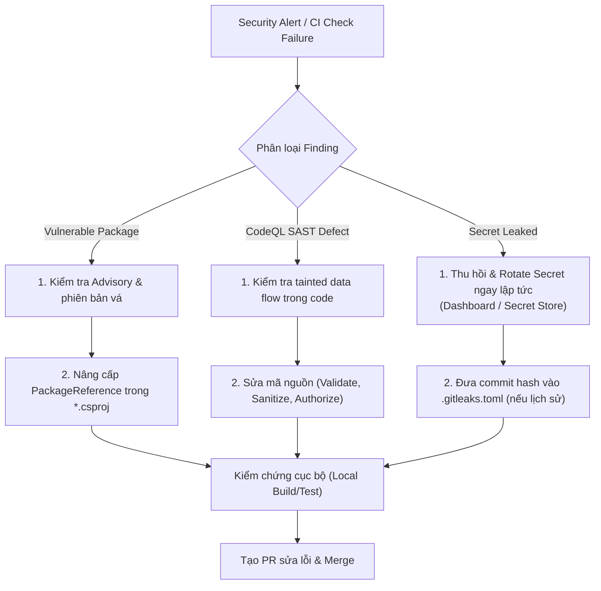

# CI/CD Security Pipeline & Vulnerability Management

Tài liệu này mô tả kiến trúc, công cụ, điều kiện kích hoạt (trigger), quy trình xử lý phát hiện (finding) và quản lý ngoại lệ (false-positive) cho hệ thống bảo mật tự động trong CI/CD pipeline của dự án.

---

## 1. Tổng quan Kiến trúc Security Pipeline

Hệ thống CI/CD được phân tách thành hai workflow chính độc lập nhằm bảo đảm tốc độ phản hồi và độ tin cậy:

| Workflow | File định nghĩa | Mục đích | Công cụ sử dụng | Môi trường chạy |
| :--- | :--- | :--- | :--- | :--- |
| **Backend CI** | `.github/workflows/backend-ci.yml` | Build, test chức năng, kiểm tra tính toàn vẹn tài liệu và rà soát lỗ hổng thư viện trực tiếp | `dotnet test`, `dotnet list package --vulnerable`, scripts xác thực | Windows Runner |
| **Security & Vulnerability Analysis** | `.github/workflows/security.yml` | Secret scanning, SAST tĩnh mã nguồn, và dependency review cho Pull Requests | Gitleaks, GitHub CodeQL (C#), Dependency Review | Ubuntu / Windows Runners |

---

## 2. Các công cụ kiểm tra và điều kiện kích hoạt

### 2.1. Secret Scanning (Gitleaks)
- **Công cụ:** `gitleaks/gitleaks-action@v2` kết hợp cấu hình `.gitleaks.toml`.
- **Cơ chế:** Quét toàn bộ lịch sử git và diff commit để phát hiện các mẫu credential (API keys, JWT secrets, passwords).
- **Bảo vệ rò rỉ log:** Bật cờ `GITLEAKS_ENABLE_REDACT: "true"` để che mờ (redact) toàn bộ giá trị nhạy cảm trong log của GitHub Actions nếu có vi phạm.
- **Trigger:** Chạy trên mọi commit đẩy lên nhánh `main`, mọi Pull Request hướng vào `main`, và lịch quét định kỳ hàng tuần (`0 3 * * 1` - 03:00 UTC thứ Hai).

### 2.2. Static Application Security Testing (SAST - CodeQL)
- **Công cụ:** `github/codeql-action` phiên bản `@v3`.
- **Ngôn ngữ phân tích:** C# (`csharp`).
- **Cơ chế:** Phân tích semantic AST và data flow để phát hiện các lỗ hổng Injection (SQLi, Command Injection), Path Traversal, Insecure Deserialization, Hardcoded Credentials, Missing Authorization.
- **Trigger:** Push vào `main`, Pull Request vào `main`, và lịch quét định kỳ hàng tuần.

### 2.3. Dependency Vulnerability Review & NuGet Audit
- **Trong Pull Request:** Sử dụng `actions/dependency-review-action@v4` để rà soát thay đổi trong dependencies của PR và chặn PR nếu phát hiện CVE mức độ `high` hoặc `critical`.
- **Trong Backend CI:** Chạy lệnh native `dotnet list TheBoys.slnx package --vulnerable --include-transitive` trong job build/test, bảo đảm mọi gói phụ thuộc trực tiếp và bắc cầu đều được kiểm tra trước khi pass pipeline.
- **Đặc điểm:** Không yêu cầu quyền đặc biệt của GitHub và có thể tái hiện 100% tại môi trường local của kỹ sư.

---

## 3. Quy trình Triage và Xử lý Lỗ hổng (Finding Remediation)

Khi một security check bị fail trên CI hoặc phát sinh Security Alert trên GitHub Security tab:



### 3.1. Đối với Secret Scanner Finding
1. **KHÔNG** cố gắng chạy `git reset --hard` hoặc rewrite Git history đã push lên remote vì sẽ gây xung đột cho toàn bộ thành viên và CI/CD.
2. Truy cập dashboard của bên cung cấp (Meshy, Tripo, Database, Cloud Provider) và **thu hồi (revoke) key bị lộ ngay lập tức**.
3. Cấp phát key mới và lưu trữ an toàn trong Secret Store (GitHub Secrets, Azure Key Vault, User Secrets).
4. Tham khảo chi tiết tại runbook: [secret-management-and-incident-runbook.md](./secret-management-and-incident-runbook.md).

### 3.2. Đối với NuGet Vulnerability Finding
1. Chạy cục bộ:
   ```bash
   dotnet list TheBoys.slnx package --vulnerable --include-transitive
   ```
2. Xác định gói thư viện và phiên bản tối thiểu an toàn.
3. Cập nhật `<PackageReference>` trong project tương ứng, chạy `dotnet restore` và toàn bộ test suite để bảo đảm không bị breaking change.

### 3.3. Đối với CodeQL SAST Finding
1. Đọc luồng dữ liệu (source -> sink) được CodeQL cảnh báo.
2. Áp dụng các mẫu thiết kế an toàn: dùng parameterized query, kiểm tra boundary, tránh truyền unchecked input vào file system hoặc shell execution.

---

## 4. Xử lý False-Positive và Quản lý Allowlist

Trong trường hợp phát hiện là giả dương tính (false-positive) hoặc là dữ liệu mẫu hợp lệ (ví dụ chuỗi test vô hại, commit lịch sử đã được vô hiệu hóa):

### 4.1. Cấu hình Allowlist cho Gitleaks (`.gitleaks.toml`)
File `.gitleaks.toml` tại thư mục gốc repository quản lý các trường hợp ngoại lệ:
- `commits`: Danh sách hash commit lịch sử cần bỏ qua (ví dụ commit `a7a5006c636fafc1d1f4667fe50e91b32582e183` đã được ghi nhận trong runbook).
- `paths`: Danh sách regex đường dẫn được miễn trừ quét (ví dụ test fixtures, tài liệu hướng dẫn `docs/**`).
- `regexes`: Danh sách regex cho các chuỗi placeholder an toàn (ví dụ `test-only-secret-not-for-real-use-0123456789`).

> **Lưu ý an toàn:** Tuyệt đối không thêm secret thật vào `regexes` của `.gitleaks.toml`.

### 4.2. Xử lý False-Positive trong CodeQL
- Nếu CodeQL cảnh báo sai về luồng dữ liệu an toàn, sử dụng tính năng "Dismiss Alert" trên giao diện GitHub Security với lý do `False Positive` hoặc `Used in Tests`.
- Bắt buộc phải có comment giải thích lý do kỹ thuật trong review pull request.

---

## 5. Hướng dẫn Kiểm tra Bảo mật Cục bộ (Local Verification)

Kỹ sư phát triển có thể kiểm tra trước khi đẩy code lên remote:

```bash
# 1. Quét lỗ hổng package NuGet trực tiếp
dotnet list TheBoys.slnx package --vulnerable --include-transitive

# 2. Chạy toàn bộ test suite bao gồm các bài test proxy/rate-limiting và model height
dotnet test TheBoys.slnx

# 3. Kiểm tra tính toàn vẹn tài liệu và schema thiết kế
./scripts/Verify-Design.ps1 -Server '(localdb)\MSSQLLocalDB'
./scripts/Verify-Docs.ps1
```
